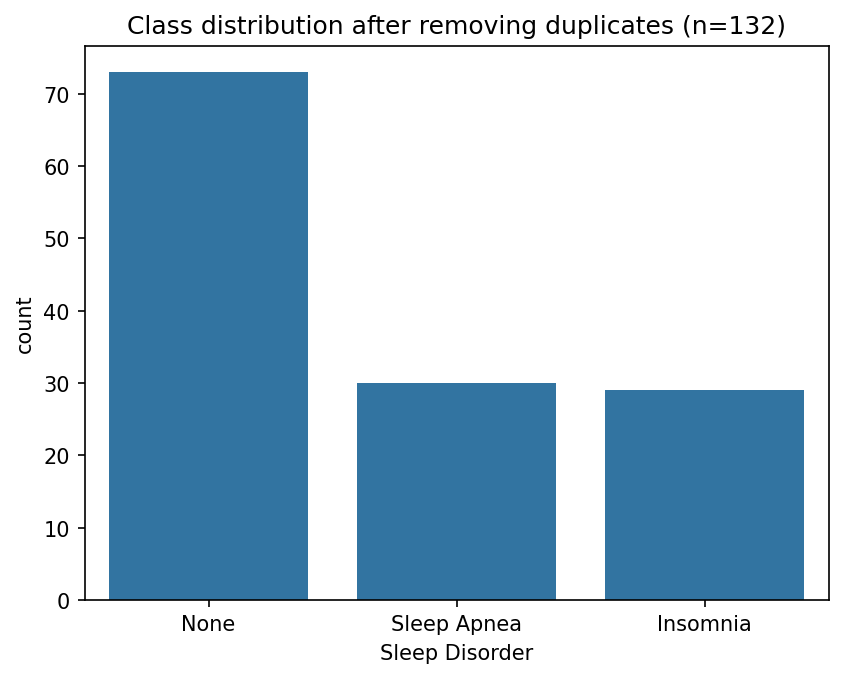
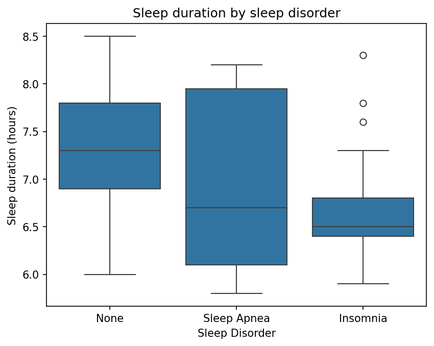
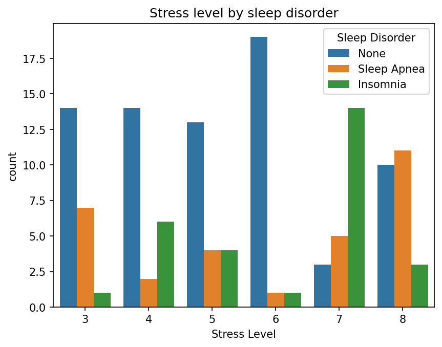
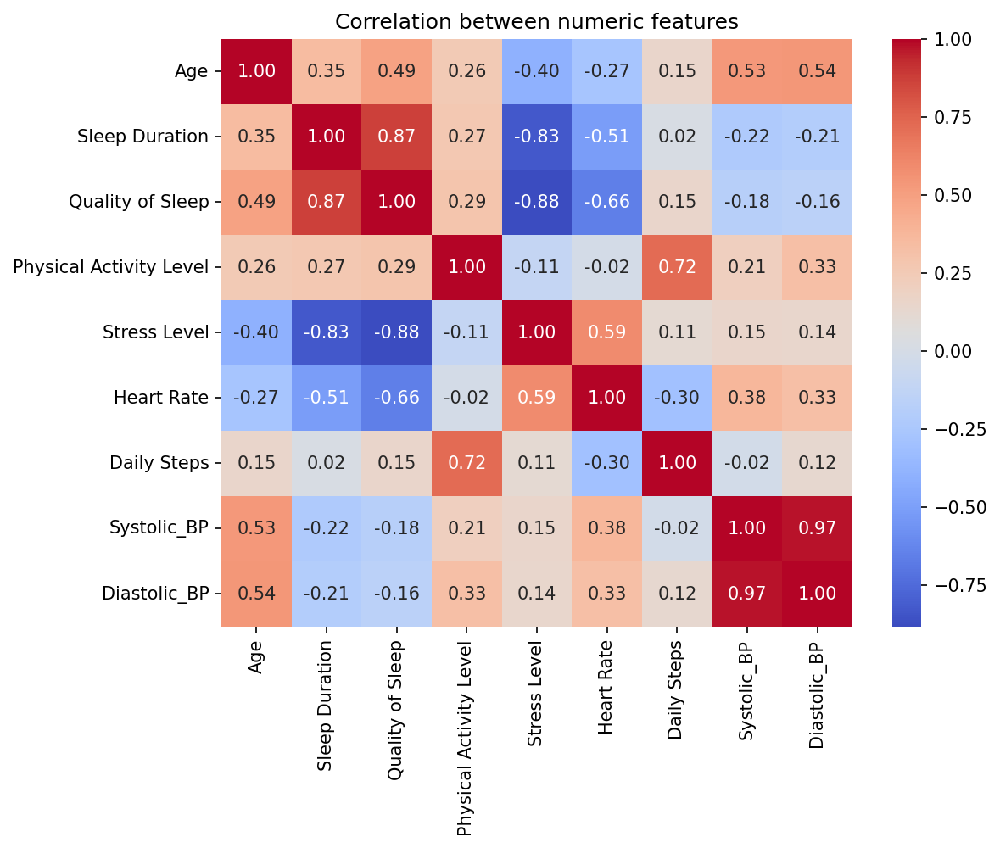
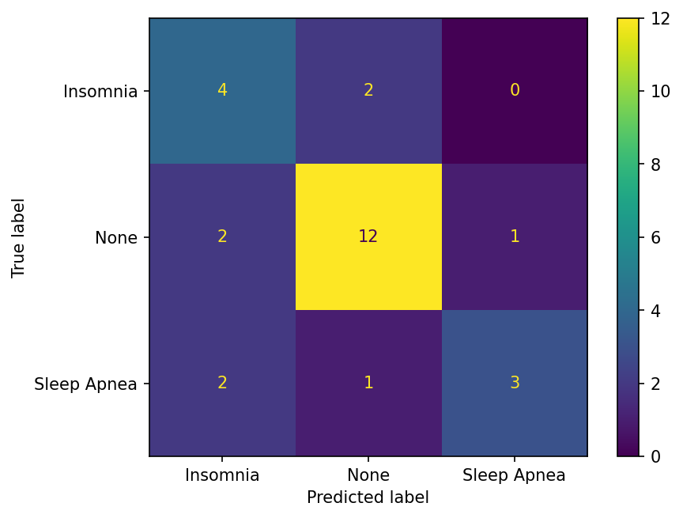
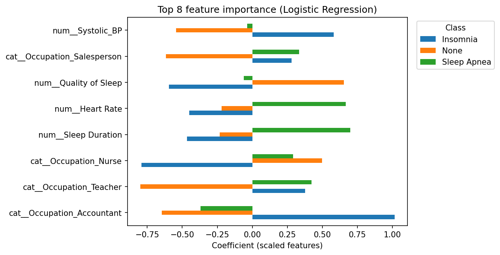

# Sleep Disorder Classification

A beginner-friendly machine learning project that predicts whether a person has **no sleep disorder, insomnia, or sleep apnea** from lifestyle and health measurements. It covers the full workflow: exploration, cleaning, leakage-safe preprocessing, model comparison against a baseline, evaluation, and interpretation.

> **Learning project.** This is not a medical tool and must not be used to diagnose anyone.

## Why this problem

Sleep quality is closely tied to attention, memory, mood, and decision-making, which makes sleep data a natural entry point into cognitive science. The question here is simple: *can everyday lifestyle and physiological measures (sleep duration, stress, heart rate, blood pressure, and so on) separate people with different sleep disorders?*

## Dataset

- **Source:** [Sleep Health and Lifestyle Dataset on Kaggle](https://www.kaggle.com/datasets/uom190346a/sleep-health-and-lifestyle-dataset). It is described as a synthetic dataset of fictive people, so it is suitable for practice but not for real-world conclusions.
- **Original size:** 374 rows, 13 columns
- **Features:** gender, age, occupation, sleep duration, quality of sleep, physical activity level, stress level, BMI category, blood pressure, heart rate, daily steps
- **Target:** `Sleep Disorder` (None, Insomnia, Sleep Apnea)

### A data-quality problem I found

**242 of the 374 rows (65%) were exact duplicates** once the ID column was dropped. Left in, identical rows land in both the training and test sets, so the model is partly tested on data it has already seen. Before removing them, accuracy looked like about 0.95. After removing duplicates, **132 unique rows** remain and scores drop to realistic levels. Everything below uses the deduplicated data.

## Approach

1. **Cleaning:** dropped the ID column, split blood pressure (`126/83`) into systolic and diastolic numeric columns, merged the duplicate BMI label ("Normal Weight" → "Normal"), and removed duplicate rows. The CSV is read with `keep_default_na=False` because the label "None" would otherwise be parsed as a missing value.
2. **Exploration:** class balance, sleep duration and stress by disorder, correlation heatmap.
3. **Split before preprocessing:** 80/20 stratified train/test split (105 train, 27 test), done before any scaling or encoding to avoid data leakage.
4. **Preprocessing pipeline:** `ColumnTransformer` with `StandardScaler` for numeric columns and `OneHotEncoder` for categorical columns, wrapped in a scikit-learn `Pipeline` together with the model.
5. **Models compared:** Logistic Regression, Decision Tree, Random Forest, plus a "most frequent class" baseline.
6. **Model selection:** 5-fold cross-validation on the training set. The test set was used only once, at the end.
7. **Evaluation:** classification report and confusion matrix on the test set.
8. **Interpretation:** logistic regression coefficients per class.

## Exploratory analysis

### Class balance



After deduplication the data has 132 people: roughly 73 with no disorder, 30 with sleep apnea, and 29 with insomnia. About 55% of rows are "None", so a model that always predicts "None" already scores around 0.56. That is the baseline any real model must beat.

### Sleep duration



People with no disorder sleep about 7.3 hours at the median. Insomnia is tightly clustered near 6.5 hours, while sleep apnea has the widest spread (median about 6.7) and overlaps both other groups.

### Stress level



Most people with low-to-moderate stress (3 to 6) have no disorder. Insomnia peaks at stress level 7 (14 people, versus 3 with no disorder), and sleep apnea is most common at level 8 (11 people, versus 10 with no disorder). The counts are small, so this is a pattern in this dataset, not a general rule.

### Correlations between features



Several features overlap strongly: sleep duration and quality of sleep (0.87), stress and quality of sleep (-0.88), stress and sleep duration (-0.83), systolic and diastolic blood pressure (0.97), and physical activity and daily steps (0.72). With this much overlap, a model can split credit among related features somewhat arbitrarily, so individual coefficients should be read cautiously.

## Results

Model comparison using 5-fold cross-validation on the training set. The baseline always predicts the most common class and scored 0.556 on the test set.

| Model | CV accuracy (mean) | CV std | Train accuracy |
|---|---|---|---|
| Logistic Regression | 0.752 | 0.082 | 0.829 |
| Random Forest | 0.629 | 0.106 | 0.838 |
| Decision Tree | 0.533 | 0.092 | 0.838 |

**Best model: Logistic Regression**, chosen by cross-validation rather than by test score. On the held-out test set (27 people) it reached **0.70 accuracy** against the 0.556 baseline.

| Class | Precision | Recall | F1 | Support |
|---|---|---|---|---|
| Insomnia | 0.50 | 0.67 | 0.57 | 6 |
| None | 0.80 | 0.80 | 0.80 | 15 |
| Sleep Apnea | 0.75 | 0.50 | 0.60 | 6 |

Macro F1 is 0.66.



Of 27 test people, 19 were classified correctly (4 of 6 insomnia, 12 of 15 none, 3 of 6 sleep apnea). Mistakes are spread across all three classes rather than concentrated in one pair, and with only 6 test examples per disorder, per-class differences are uncertain.

### Which features mattered



In the logistic regression coefficients, higher quality of sleep pushed predictions toward "None" and away from insomnia, while higher heart rate and longer sleep duration pushed toward sleep apnea, and higher systolic blood pressure pushed toward insomnia. The sleep duration result looks odd next to the boxplot above, which is a symptom of sleep duration and sleep quality being highly correlated (0.87): the model shares credit between them. Several occupation categories also rank highly, but with very few people per occupation this is most likely an artifact of the small sample rather than a real link between job and disorder.

These patterns are partly plausible. Good sleep quality going with no disorder, and raised heart rate and blood pressure going with disorders, match what is generally expected. But coefficients describe associations in this synthetic dataset, not causes.

## Key findings

- **The simple model won.** Logistic regression beat the tree and forest. The tree and forest score much higher on training data than in cross-validation, a sign of overfitting on a small dataset.
- **Better than guessing, but modest.** The best model clearly beats the baseline (0.70 versus 0.556 on the test set), but the gap is far smaller than the pre-deduplication numbers suggested.
- **Duplicates matter.** Checking for duplicate rows changed the headline accuracy from about 0.95 to about 0.70.
- **Features are heavily entangled.** Sleep duration, sleep quality, and stress move together, which limits how much any single coefficient can be trusted.

## Limitations

- Very small dataset (132 unique rows after deduplication) and a very small test set (27 rows), so every number here has wide uncertainty.
- The data is synthetic, with many near-identical records, so it does not reflect real patients.
- Features are simple measurements or self-reports; there is no polysomnography or clinical diagnosis data.
- Correlated features make individual coefficients unstable.
- Not suitable for any medical decision.

## How to run

```bash
git clone https://github.com/ninganagoudadhannur30-web/Sleep-disorder-classification.git
cd Sleep-disorder-classification
python -m venv venv
venv\Scripts\activate        # Windows (macOS/Linux: source venv/bin/activate)
pip install -r requirements.txt
jupyter notebook notebooks/01_eda_and_modeling.ipynb
```

## Project structure

```
├── data/            # Sleep Health and Lifestyle CSV
├── figures/         # Saved plots used in this README
├── notebooks/       # 01_eda_and_modeling.ipynb
├── requirements.txt
└── README.md
```

## Tech stack

Python, pandas, NumPy, scikit-learn, matplotlib, seaborn, Jupyter

## What I learned

- **Split before preprocessing.** Fitting scalers and encoders on the training data only, inside a `Pipeline`, keeps information from the test set from leaking into the model.
- **Always compare against a baseline.** About 55% of the rows are "None", so accuracy only means something relative to that.
- **Check for duplicate rows.** Removing 242 duplicates cut my accuracy from about 0.95 to about 0.70 and showed how easily a small dataset can give misleading results.
- **Simple models can win on small data.** Logistic regression beat the more flexible models, which overfit.
- **Be careful reading coefficients.** Highly correlated features share credit, so a single bar in the plot can mislead.

## Next steps

- Hyperparameter tuning with `GridSearchCV`
- Try additional models (SVM, gradient boosting) with repeated cross-validation, which would give more stable estimates than a single 27-row test set
- Test on a larger, real-world sleep dataset

## AI assistance

Built as a learning project with AI assistance for explanations, debugging, and code review. I ran, modified, and tested the code myself.
